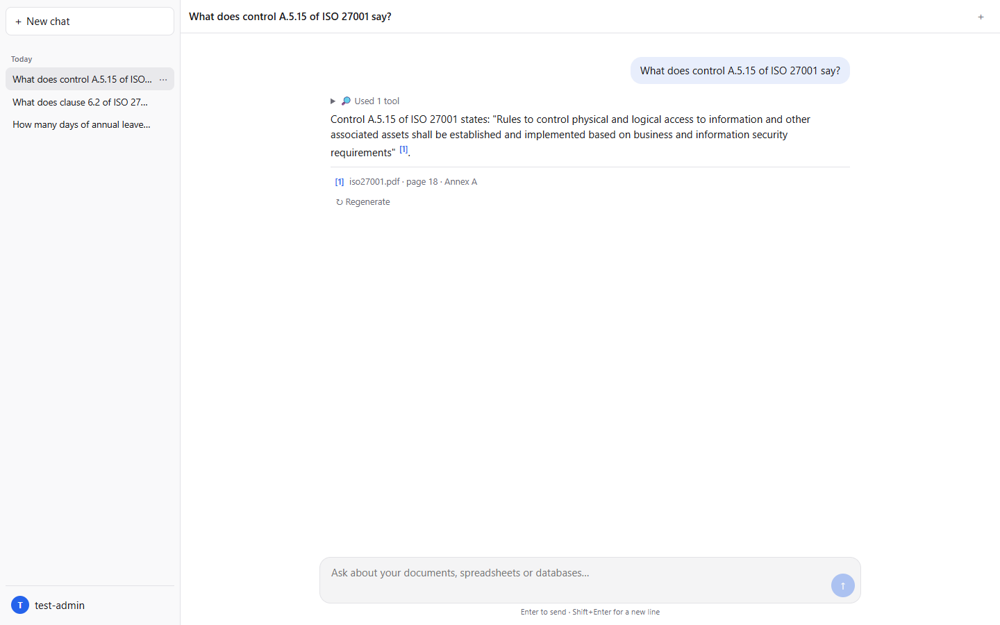
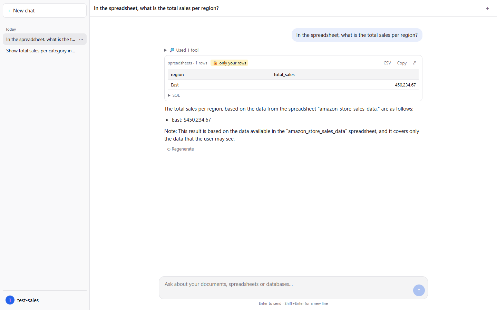
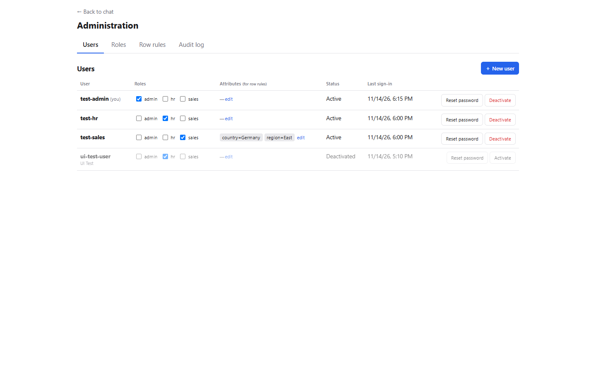
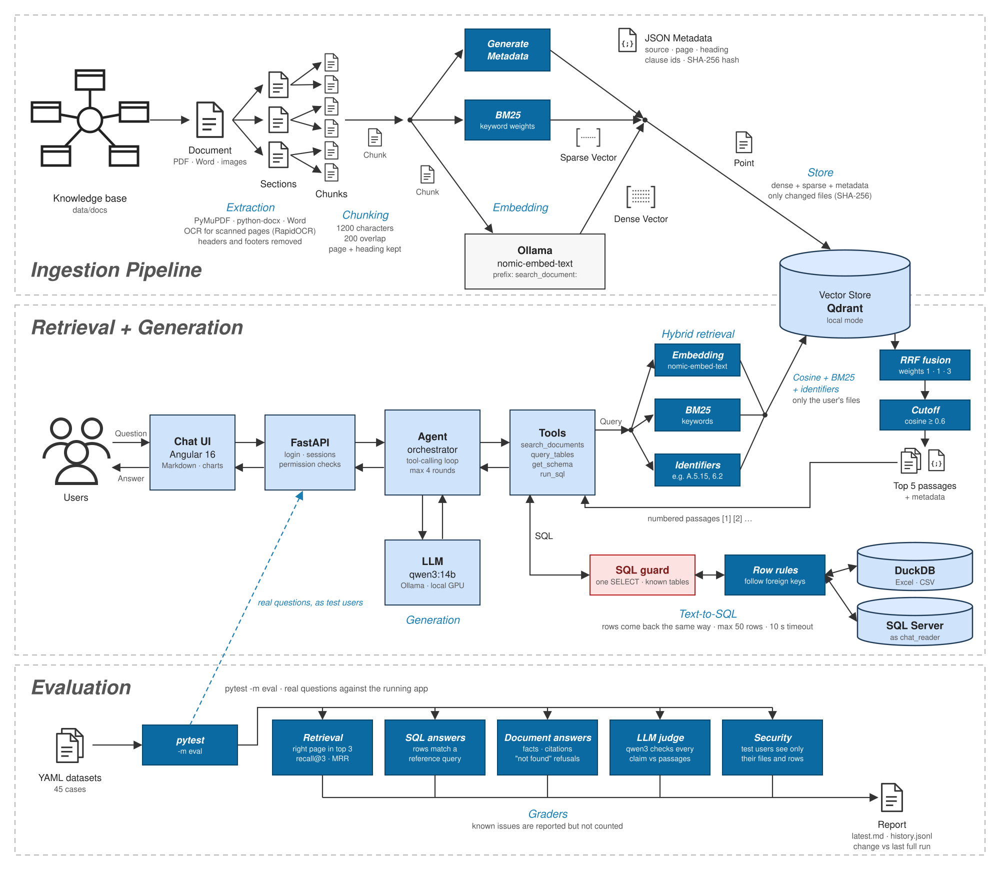
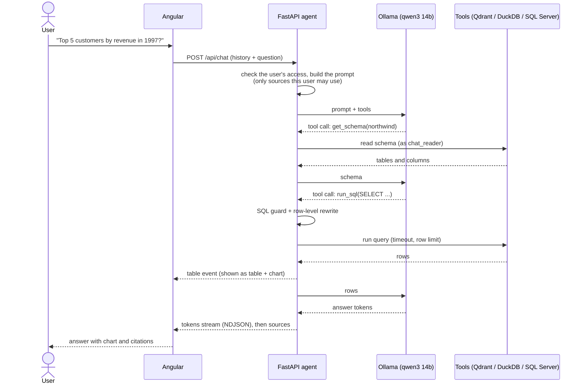

# RAG Chat – on-premise AI

A ChatGPT-style chat application that answers questions from **your own documents, Excel sheets and
SQL Server databases**. Everything runs on your own machine: the language model, the embeddings, the
vector database and the data. No cloud API is used and no data leaves the computer.

- Answers from documents always carry citations (file, page, section).
- Number questions are answered by running real SQL, and the result is shown as a table and a chart.
- Every user signs in, and roles decide which folders, spreadsheets and databases they can use.
  Row rules can limit a user to their own region, country and so on.
- An evaluation suite measures the answer quality, so a change that makes answers worse is caught.


---

## Screenshots

| Answer from a document, with citation | Row-level permission (user sees only the East region) |
|---|---|
|  |  |

| Spreadsheet answer in dark mode | Admin – users and their attributes |
|---|---|
|  |  |

| Admin – roles | Admin – row rules |
|---|---|
|  |  |

---

## Overall architecture



The diagram is a draw.io file. To change it, open `docs/images/architecture.drawio.svg` in
[draw.io](https://www.drawio.com) (desktop app, or the "Draw.io Integration" extension in VS Code) and save
it again; GitHub shows the updated picture.

**1. Ingestion pipeline** – runs when the admin indexes the documents.

- **Extraction:** PDF, Word and image files from `data/docs` are read into sections (text with page and
  heading). Scanned pages are read with OCR, and repeated headers and footers are removed.
- **Chunking:** sections are cut into chunks of about 1200 characters with 200 characters of overlap.
- **Embedding:** every chunk gets a dense vector (meaning, from `nomic-embed-text`), a sparse BM25 vector
  (keywords) and metadata (source, page, heading, clause numbers, file hash).
- **Store:** each chunk is saved as one point in Qdrant. Only changed files are processed again.
- **Spreadsheets** are not chunked. Each sheet becomes a table in DuckDB (total rows dropped), and it is
  loaded again when the file changes.

**2. Retrieval + generation** – runs for every question.

- The user asks in the Angular chat. FastAPI checks the session and what this user is allowed to see.
  Accounts, roles and the audit log are in the `RagChatApp` database; saved chats are in SQLite.
- **Prompt helpers:** before the model starts, a quick pre-search tells it which files have related
  passages (so it does not answer from its own knowledge), and a short reminder in the latest question
  tells it to look things up again instead of reusing numbers from earlier answers.
- The **agent** gives the question to `qwen3:14b` along with the tools. The model decides which tool it
  needs, for at most 4 rounds.
- **Hybrid retrieval** (documents): the question is searched three ways – by meaning, by keywords, and by
  meaning again only among chunks that contain the clause number asked for (like A.5.15) – and only in
  files the user may see. The top 20 of each list are merged with RRF (weights 1, 1, 3). Matches with
  cosine below 0.6 are dropped, except the exact clause that was asked for, and the top 5 passages go
  back to the model with numbers for citations.
- **Text-to-SQL** (spreadsheets and databases): the model writes SQL. The SQL guard allows only one
  read-only SELECT, row rules filter the rows, and the query runs in DuckDB or in SQL Server as the
  read-only `chat_reader`.
- The model writes the answer from these results, and it streams back to the user with citations,
  tables and charts.

**3. Evaluation** – `pytest -m eval`, run by the developer.

- 45 questions with known good answers (YAML files) are asked to the running app, as the test users.
- Five graders check them: retrieval (right page in the top 3), SQL answers (same rows as a reference
  query), document answers (facts, citations, "not found"), the LLM judge (every claim supported by the
  passages) and security (users see only their files and rows).
- The result is written to a report that shows the change since the last full run.

**How one question is answered**



---

## Models used

| Purpose | Model | Size | Notes |
|---|---|---|---|
| Chat, tool calling, SQL writing | `qwen3:14b` (Ollama) | 9.3 GB | Thinking mode is off (`THINK=false`): about 7 times faster and reliable for tool calls. Context window 16,384 tokens. |
| Embeddings for document search | `nomic-embed-text` (Ollama) | 274 MB | Uses the `search_document:` / `search_query:` prefixes. |
| Keyword search | BM25 (sparse vectors in Qdrant) | – | Finds rare exact words like "Repos". |
| OCR for scanned pages and images | RapidOCR (ONNX Runtime) | comes with the pip package | Runs offline. |
| Answer checking in the evaluation | `qwen3:14b` as judge | – | `temperature=0`, JSON output. |

Tested on a laptop with an RTX 5090 (24 GB VRAM) and 64 GB RAM. A GPU with about 12 GB VRAM can run
`qwen3:14b`; with less memory, a smaller model such as `qwen3:8b` can be set in `.env` (`CHAT_MODEL=...`).

---

## Tech stack

| Layer | Used |
|---|---|
| Frontend | Angular 16 (NgModules), marked + DOMPurify (safe Markdown), Chart.js |
| Backend | Python 3.12, FastAPI, uvicorn, pydantic-settings |
| LLM runtime | Ollama |
| Vector search | Qdrant (local mode), hybrid search: dense + BM25 + identifiers, merged with RRF |
| Spreadsheets | pandas + DuckDB (in memory, sandboxed) |
| Databases | SQL Server with Windows authentication, pyodbc, ODBC Driver 18 |
| SQL safety | sqlglot (only one SELECT on known tables, row-level rewrite) |
| Documents | PyMuPDF (PDF), python-docx (Word), Word COM via pywin32 (old `.doc`), RapidOCR |
| Accounts | SQL Server database `RagChatApp`, bcrypt, server-side sessions |
| Tests | pytest, ruff |

---

## Setup

The commands are for **Windows (PowerShell)**, because the app uses Windows authentication for SQL Server
and Word for old `.doc` files.

### 1. Install the requirements

| Tool | Version used |
|---|---|
| Python | 3.12 |
| Node.js + Angular CLI | Node 18 or later, `npm install -g @angular/cli@16` |
| Ollama | latest, from ollama.com |
| SQL Server | 2019 or later (Developer or Express edition) with Windows authentication |
| ODBC Driver 18 for SQL Server | from Microsoft |
| Microsoft Word | optional, only needed for old `.doc` files |

### 2. Download the models

```bash
ollama pull qwen3:14b
```

```bash
ollama pull nomic-embed-text
```

### 3. Prepare SQL Server

Import the Microsoft sample databases **Northwind** (`instnwnd.sql`) and **pubs** (`instpubs.sql`).
Use `-f 65001` so that accented names are read as UTF-8:

```bash
sqlcmd -S localhost -E -f 65001 -i instnwnd.sql
```

```bash
sqlcmd -S localhost -E -f 65001 -i instpubs.sql
```

Then run the two scripts of this project. Both are safe to run again.

```bash
sqlcmd -S localhost -E -i db-scripts\create_chat_reader.sql
```

```bash
sqlcmd -S localhost -E -i db-scripts\create_app_database.sql
```

- `create_chat_reader.sql` creates `chat_reader` in Northwind and pubs: a user without login that can only read.
  All SQL written by the model runs as this user.
- `create_app_database.sql` creates the `RagChatApp` database (users, roles, row rules, sessions, audit log)
  and the `chat_app` user that the app uses for it.

### 4. Backend

```bash
cd backend
```

```bash
py -3.12 -m venv .venv
```

```bash
.\.venv\Scripts\pip install -r requirements-dev.txt
```

Settings have defaults in `backend/app/config.py`. To change any of them, create `backend/.env`, for example:

```ini
CHAT_MODEL=qwen3:14b
EMBED_MODEL=nomic-embed-text
THINK=false
SQL_SERVER=localhost
```

Create your admin account (it asks for the password):

```bash
.\.venv\Scripts\python -m app.auth.cli create-admin your-name
```

Start the backend:

```bash
.\.venv\Scripts\python -m uvicorn app.main:app --reload --reload-dir app --port 8000
```

Check http://localhost:8000/api/health – it shows whether Ollama and the chat model are ready.

### 5. Frontend

```bash
cd frontend
```

```bash
npm install
```

```bash
npm start
```

Open http://localhost:4200 and sign in with the admin account.

### 6. Index the documents

Documents must be indexed once, and again after files change (only changed files are processed).
Sign in to the app as admin first, then open http://localhost:8000/docs, choose
`POST /api/documents/index` and click **Try it out → Execute**. The same browser session cookie is used.

---

## Adding your own data

| Data | Where to put it |
|---|---|
| PDF, Word (`.docx`, `.doc`), images (`.png`, `.jpg`) | `data/docs/`. Sub-folders work as permission folders, for example `data/docs/hr/` is visible only to roles with the `hr` folder. Run the indexing again after adding files. |
| Excel and CSV (`.xlsx`, `.xls`, `.csv`) | `data/docs/`. Each sheet becomes a SQL table. Changes are picked up automatically. |
| SQL Server databases | Add an entry to `backend/databases.json` (name, database, description, notes such as formulas), and create `chat_reader` in that database (add it to `db-scripts/create_chat_reader.sql`). |

Users, roles, user attributes and row rules are managed on the **Admin** page.

---

## Security in short

- The model's SQL runs as read-only users (`chat_reader` in SQL Server; DuckDB without file or network access),
  and must pass the SQL guard: only one SELECT, only known tables, timeout and row limit.
- Row rules rewrite each query so a user sees only their rows. Rules follow foreign keys
  (a rule on Customers also limits Orders and Order Details). A user without the attribute sees no rows.
- Every endpoint and every tool checks the user's permissions again. Document search is filtered to the
  allowed files.
- Sessions use an HttpOnly, SameSite=Strict cookie; only a hash of the token is stored. Passwords use
  bcrypt, and accounts are locked after 5 wrong passwords in 15 minutes.
- The model's answer is cleaned with DOMPurify before it is shown (protection against prompt injection
  writing HTML).
- The audit log can only be added to; UPDATE and DELETE are denied in the database.

---

## Tests

From the `backend` folder:

```bash
.\.venv\Scripts\python -m pytest
```

Runs the fast unit and integration tests (about 30 seconds).

```bash
.\.venv\Scripts\python -m pytest -m eval
```

Runs the evaluation against the running app (about 2 minutes; backend, Ollama and SQL Server must be
running, and test accounts are created with `python -m app.auth.cli seed-test-users`). It checks:

| Area | What is measured |
|---|---|
| retrieval | the right file and page in the top 3 (recall@3, MRR) |
| sql | the model's result contains the rows of a reference query |
| documents | facts present, right passage cited, "not found" when the answer is not in the documents |
| judge | the local model checks every statement is supported by the passages |
| security | users get only what their role and row rules allow |

The report is written to `backend/tests/eval/reports/latest.md`, with the change since the last full run.

---

## Project structure

```
backend/
  app/
    agent.py          tool-calling loop, prompts, citations
    tools/            search_documents, query_tables, get_schema, run_sql
    ingest/           loaders (PDF, Word, OCR), chunker, embeddings, Qdrant store, indexer
    tables/           Excel/CSV -> DuckDB
    databases/        SQL Server connections, schema cache, queries
    sql_guard.py      read-only SQL check
    row_filter.py     row-level rewrite
    auth/             accounts, sessions, roles, CLI
    routers/          REST endpoints
  databases.json      databases the model may use, with notes
  tests/              fast tests, and tests/eval for the evaluation
frontend/src/app/
  chat/               chat page, sidebar, result cards, charts
  auth/               sign-in and change-password pages, guards, interceptor
  admin/              users, roles, row rules, audit log
db-scripts/           SQL Server setup scripts
data/docs/            sample documents and spreadsheet
docs/NOTES.md         what I learned in each step of building this
```

---

## Learning notes

##This project was built step by step as a learning exercise. The reasons behind each decision and the
##problems I faced are written in [docs/NOTES.md](docs/NOTES.md).
